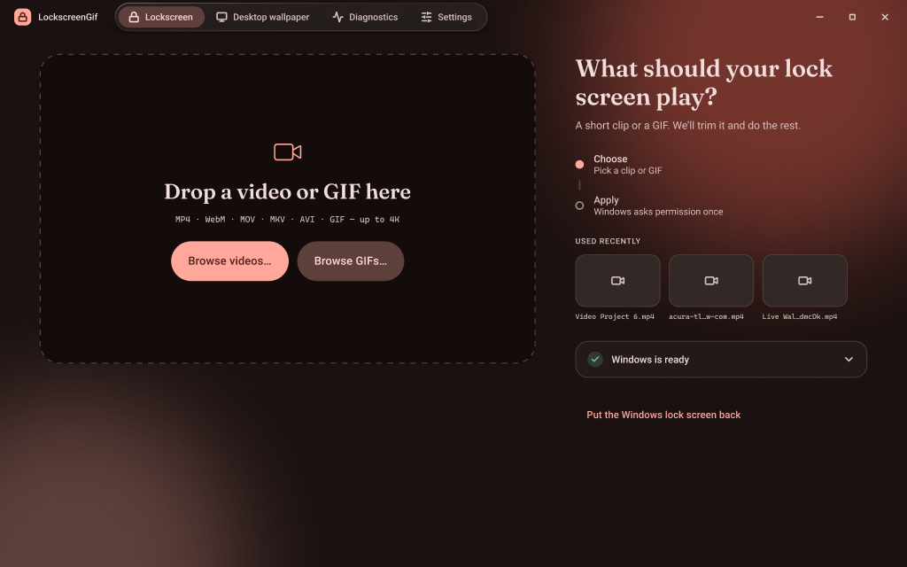

<p align="center">
  
</p>

<h1 align="center">LockscreenGif</h1>

<p align="center">
  <strong>Next-Generation Windows 11 Lock Screen & Live Desktop Wallpaper Suite</strong><br>
  <em>Breathe life into your lock screen and desktop with silky-smooth video loops, animated GIFs, and interactive web wallpapers.</em>
</p>

<p align="center">
  <a href="https://github.com/SubhamPro11/lockscreengtf/actions/workflows/dotnet-desktop.yml"></a>
  <a href="https://github.com/SubhamPro11/lockscreengtf/actions/workflows/format.yml"></a>
  <a href="https://github.com/SubhamPro11/lockscreengtf"></a>
  <a href="https://dotnet.microsoft.com/download/dotnet/10.0"></a>
  <a href="https://github.com/SubhamPro11/lockscreengtf/releases"></a>
  <a href="LICENSE.txt"></a>
</p>

<p align="center">
  <a href="https://github.com/SubhamPro11/lockscreengtf/releases/latest"><b>🚀 Download Installer</b></a> •
  <a href="https://github.com/SubhamPro11/lockscreengtf/releases/latest"><b>📦 Portable ZIP</b></a> •
  <a href="https://lockscreen-gtf-web.morbius.workers.dev"><b>🌐 Official Website</b></a> •
  <a href="#-quick-start"><b>⚡ Quick Start</b></a> •
  <a href="docs/DESKTOP_WALLPAPER.md"><b>📖 Developer Guide</b></a>
</p>

---

<p align="center">
  
</p>

---

## ✨ Features at a Glance

| Feature | Description |
|---|---|
| 🔒 **Native Animated Lock Screen** | Converts high-fps clips into Windows lock-screen cache animations. Plays via the native Windows Desktop Window Manager (`dwm.exe`) — the app closes with **0% ongoing CPU and 0 MB RAM usage**. |
| 🖥️ **Live Desktop Wallpaper Engine** | Smooth, hardware-accelerated video loops and interactive web applications rendered directly behind Windows desktop icons. |
| ⚡ **Intelligent Battery & Game Guard** | Automatically pauses animations when fullscreen games or apps are focused, when desktop is completely covered, or when Windows enters Battery Saver mode. |
| 🎵 **Audio-Reactive Visuals** | Real-time WASAPI audio loopback streaming with spectrum frequency analysis, allowing web wallpapers to react dynamically to music and system sound. |
| 🛡️ **Fail-Safe Restoration** | Automatically backs up your current Windows static wallpaper. Restores cleanly when stopping, closing the app, or if `explorer.exe` restarts. |
| 💎 **Windows 11 Fluent Glass UI** | Polished WinUI 3 interface with Mica material, Segoe UI Variable typography, sharp rendering, and complete Light, Dark, and High Contrast support. |

---

## 🎯 Dual Experience: Lock Screen vs. Desktop Wallpaper

| Capability | 🔒 Animated Lock Screen | 🖥️ Live Desktop Wallpaper |
|---|---|---|
| **Rendering Host** | Windows System Compositor (`dwm.exe`) | Isolated `WorkerW` Desktop Layer |
| **Ongoing Resource Usage** | **0% CPU / 0 MB RAM** (App exits cleanly) | GPU hardware decoded (~0.5–1.5% CPU) |
| **Supported Formats** | Videos (`mp4`, `webm`, `mkv`), GIFs | Videos, GIFs, HTML5, WebGL, Web URLs, Shaders |
| **Multi-Monitor Modes** | Primary Lock Display | Span across all, Duplicate, or Target specific display |
| **Audio Playback** | Silent (Windows Lock Screen standard) | Volume control, Mute toggle, WASAPI Audio Reactivity |
| **Application State** | One-time setup, then closes | Runs quietly in Windows system tray |

---

## 🚀 Quick Start

### 1. Animated Lock Screen in 3 Steps
1. **Choose Animation**: Drag and drop any video (`.mp4`, `.webm`, `.mov`, `.mkv`) or animated `.gif` into the Lockscreen tab.
2. **Trim & Customize**: Scrub through the timeline, set precise Start/End points, adjust playback speed, and fine-tune target frame rate.
3. **Apply**: Click **Set Animated Lockscreen**. LockscreenGif uses high-efficiency FFmpeg and Gifski pipelines to build pixel-perfect cache frames. Once applied, test it immediately with the in-app **Live Smoke Test**!

### 2. Live Desktop Wallpaper
1. Switch to the **Desktop Wallpaper** tab.
2. Choose a video file or enter an interactive web URL/HTML page.
3. Configure your display layout (Per-monitor, Duplicate, or Span) and audio preferences.
4. Click **Apply Wallpaper** — your live wallpaper begins running behind desktop icons instantly. Control playback at any time from the top **Now Playing** card or the Windows system tray.

---

## 📂 Supported Formats

- 🎬 **Video**: `.mp4`, `.webm`, `.mkv`, `.avi`, `.mov`, `.wmv` *(Hardware-accelerated GPU decoding via Media Foundation)*
- 🎞️ **Animation**: Animated `.gif`, animated `.webp`
- 🌐 **Interactive Web**: `.html` files, WebGL shaders, Canvas animations, remote HTTP/HTTPS URLs *(Rendered via Microsoft Edge WebView2)*
- 🖼️ **Static Graphics**: High-resolution `.png`, `.jpg`, `.jpeg`, `.bmp` with per-monitor scaling

---

## 💻 System Requirements

| Specification | Minimum | Recommended |
|---|---|---|
| **OS** | Windows 11 24H2 (Build 26100+) 64-bit | Windows 11 24H2 or newer (x64) |
| **Architecture** | x64 (AMD64 / Intel 64) | Multi-core x64 processor |
| **Runtime** | [.NET 10 Desktop Runtime (x64)](https://dotnet.microsoft.com/download/dotnet/10.0) | Bundled / Automated |
| **UI Framework** | Windows App SDK 1.8+ | Bundled with installer |
| **Web Runtime** | Microsoft Edge WebView2 Evergreen | Pre-installed on Windows 11 |

---

## 📦 Installation

Choose your preferred installation method from [GitHub Releases](https://github.com/SubhamPro11/lockscreengtf/releases):

### Option A: MSI Installer (Recommended)
Download `LockscreenGif-*-x64.msi`. Run the installer for full Start menu integration, desktop shortcuts, and seamless update support.

### Option B: Portable Package
Download `LockscreenGif-*-win-x64.zip`. Extract the archive anywhere on your machine and run `LockscreenGif.exe` with zero installation required.

---

## 🛠️ Building from Source

### Prerequisites
- [Windows 11 SDK (10.0.26100.0)](https://developer.microsoft.com/en-us/windows/downloads/windows-sdk/)
- [.NET 10 SDK](https://dotnet.microsoft.com/download/dotnet/10.0)
- PowerShell 7+ (`pwsh`)

### Build Steps

```powershell
# 1. Clone repository
git clone https://github.com/SubhamPro11/lockscreengtf.git
cd lockscreengtf

# 2. Restore tools and project dependencies
dotnet tool restore
dotnet restore

# 3. Build in Release mode for x64
dotnet build LockScreenGif/LockScreenGif.csproj -c Release -p:Platform=x64

# 4. Run test suites to ensure 100% pass rate
Get-ChildItem Tests -Recurse -Filter *.csproj | ForEach-Object {
    dotnet run --project $_.FullName -c Release
}

# 5. Publish unpackaged distribution folder
cd LockScreenGif
dotnet publish -c Release -p:PublishProfile=FolderProfile.pubxml -p:Platform=x64
```

---

## 🔒 Security, Diagnostics & Privacy

- **Safe Privilege Boundary**: Writing to protected Windows lock-screen cache (`SystemData`) is isolated to a standalone elevated helper (`LockscreenGif.Privileged.Helper.exe`) invoked only when setting or removing the lock screen.
- **Privacy First**: Anonymous telemetry strictly records basic operational counts via PostHog (EU cluster). **No file paths, media names, or personal identifiers are ever collected.** Telemetry can be instantly toggled off anytime under **Settings > Share anonymous usage analytics**. See [docs/analytics.md](docs/analytics.md).
- **Diagnostics & ETW Logs**: In-app Event Tracing for Windows (ETW) capture and sanitized diagnostic ZIP export allow easy troubleshooting without leaking sensitive system data.

---

## 👨‍💻 Author & Maintainer

LockscreenGif is created and actively maintained by **Subham Kumar ([SubhamPro11](https://github.com/SubhamPro11))**.

Complete third-party notices, license texts, and dependency disclosures are documented in [THIRD-PARTY-NOTICES.md](THIRD-PARTY-NOTICES.md) and inside the app via **Settings > About > Open-source licenses**.

---

## 📄 License

This software is released under the [MIT License](LICENSE.txt).

```text
Copyright (c) 2026 Subham Kumar (SubhamPro11)
```
