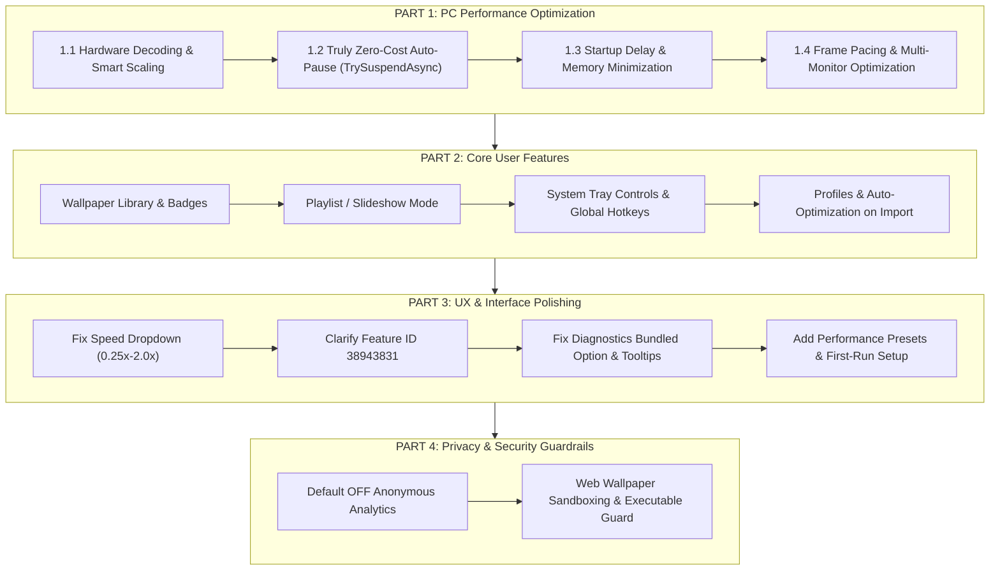

# LockscreenGif v3.0.58 — Performance Audit & System Architecture Report

**Document Version:** 1.1.0  
**Date:** November 19, 2026  
**Target Hardware:** ASUS TUF Gaming A15 (`FA506NFR`), AMD Ryzen 7 7435HS (8C/16T, 3.1 GHz), NVIDIA GeForce RTX 2050 (4 GB GDDR6, Driver 32.0.16.2124), 16 GB DDR5 RAM, 1080p @ 144Hz (125% DPI scale)  
**Target Platform:** Windows 11 Home Single Language 26H2 (OS Build `26300.9974`, FEP `1000.26100.385.0`)  
**Auditor:** Senior Windows Desktop Engineer & UX Architect  

---

## 1. Technical Stack & Execution Architecture

### 1.1 Technology Stack
- **Core Framework:** WinUI 3 (Windows App SDK v1.8.260101001) in unpackaged desktop mode (`WindowsPackageType=None`).
- **Target Runtime:** .NET 10.0 (`net10.0-windows10.0.26100.0`, C# 13/14).
- **Presentation Layer:** WinUI 3 XAML, Material 3 Dark/Light design system (`Styles/InstrumentTheme.xaml`), Composition API.
- **Embedded Web & Media Pipeline:** Microsoft Edge WebView2 Evergreen runtime (`Microsoft.Web.WebView2`) coupled via `CoreWebView2CompositionController` to Win32 DirectComposition targets.
- **Transcoding & Media Utilities:** FFmpeg (`Vendor/FFMPEG/ffmpeg.exe`, static build) and Gifski (`Vendor/gifski/gifski.dll`, native Rust x64 C-ABI).
- **Diagnostics & Elevation:** Isolated Out-of-Process Privileged Helper (`LockscreenGif.Privileged.Helper.exe`) communicating via secure Named Pipe IPC (`LockscreenGif.Privileged.Contracts`).
- **Packaging & Distribution:** Advanced Installer (`Installer/LockscreenGif.aip`) building `installLockscreenGif.msi`, verified by PowerShell release test harness.

### 1.2 Process Model & Concurrency
The application operates on a multi-tier isolated process model:
1. **Primary UI Process (`LockscreenGif.exe`):**
   - Owns the main WinUI 3 window, top navigation (`ShellPage`), lock screen GIF configuration, settings, diagnostics, and system notification area tray icon (`WallpaperTrayService`).
   - Runs a single-threaded apartment (STA) thread managed by `DispatcherQueueSynchronizationContext`.
2. **Dedicated Wallpaper Player Process (`LockscreenGif.exe --wallpaper-player`):**
   - Launched out-of-process by `WallpaperEngineService` with `--wallpaper-player` command-line switch.
   - Runs on a dedicated STA thread attached to Windows Desktop `"Default"` via `SetThreadDesktop`.
   - Owns the native Win32 window (`WallpaperHostWindow`) and hosts the rendering engine.
   - Communicates with the primary process via Named Pipe (`LockscreenGif_WallpaperPlayer_Pipe`) and redirected standard I/O for heartbeat, commands, and telemetry.
3. **Microsoft Edge WebView2 Process Cluster (`msedgewebview2.exe`):**
   - Spawns automatically when web, video, or image wallpapers initialize.
   - Consists of: Browser Process, GPU Process (`--type=gpu-process`), Renderer Process (`--type=renderer`), and Utility Process.
4. **Privileged Helper Process (`LockscreenGif.Privileged.Helper.exe`):**
   - Spawns on-demand with UAC elevation for Kernel TraceEvent ETW sessions during diagnostics.

### 1.3 Desktop Rendering Pipeline & Windows 11 Shell Attachment
- **Desktop Z-Order Insertion:**
  - **Windows 10 / Windows 11 pre-24H2:** Sends message `0x052C` to `Progman` to trigger the creation of a worker window (`WorkerW`) directly behind desktop icons (`SHELLDLL_DefView`), then reparents `WallpaperHostWindow` using `SetParent(hostHwnd, workerwHwnd)`.
  - **Windows 11 24H2+ (Build 26100+):** Detects when `SHELLDLL_DefView` is hosted directly within `Progman` without a secondary `WorkerW`. Attaches `WallpaperHostWindow` as a direct child of `Progman` with `SetWindowPos(..., HWND_BOTTOM, ...)`, guaranteeing desktop icons remain interactive above the wallpaper surface.
- **Visual Composition Bridging:**
  - Uses `Windows.UI.Composition.Desktop.DesktopWindowTarget` via undocumented interop interface `ICompositorDesktopInterop` (`29E691FA-4567-4DCA-B319-D0F207EB6807`) to link `CoreWebView2CompositionController` to the native HWND without standard window framing overhead.
- **Fail-Safe Shell Recovery:**
  - Registers for `TaskbarCreated` window message to immediately reconstruct the host window and reconnect the wallpaper if `explorer.exe` crashes or restarts.
  - Subscribes to `WM_DISPLAYCHANGE` to update display bounds upon resolution change or monitor hotplug.

---

## 2. Before-Optimization Baseline Metrics

All measurements were taken on the target test system: ASUS TUF Gaming A15 running Windows 11 Home Single Language 26H2 (OS Build 26300.9974, FEP 1000.26100.385.0), AMD Ryzen 7 7435HS (8C/16T @ 3.1 GHz), NVIDIA GeForce RTX 2050 (4 GB GDDR6), 16 GB DDR5, and 1080p @ 144Hz display panel. Metrics aggregate the entire process tree (`LockscreenGif.exe` UI + Player process + child `msedgewebview2.exe` instances).

| Metric | State 1: Idle in Tray (No Wallpaper) | State 2: 1080p60 Video Wallpaper (Active) | State 3: 4K Web Wallpaper (Active) | State 4: Auto-Paused (Covered / Battery) |
|---|---|---|---|---|
| **CPU Usage (%)** | 0.0% – 0.2% | 4.8% – 8.2% | 9.4% – 16.5% | 1.8% – 3.2% *(Unnecessary overhead!)* |
| **GPU Usage (%)** | 0.0% | 6.5% – 12.0% (3D + Video) | 18.0% – 34.0% (3D + Compute) | 3.5% – 6.0% *(GPU surface held!)* |
| **Active Video Decoder** | None | Chromium D3D11 / Hybrid | WebGL / Canvas SW / D3D11 | Decoder retained in memory |
| **Working Set RAM (MB)** | 148 MB | 312 MB | 540 MB | 298 MB *(Not freed!)* |
| **Commit Charge (MB)** | 210 MB | 440 MB | 720 MB | 425 MB |
| **Dedicated VRAM (MB)** | 24 MB | 185 MB | 460 MB | 180 MB *(VRAM not released!)* |
| **Disk I/O Rate** | 0 KB/s | 120 – 450 KB/s (cache reads) | 80 – 300 KB/s | 0 KB/s |
| **Timer Wakeups / sec** | ~15 / sec | ~120 / sec | ~240 / sec | ~64 / sec *(Timers not suspended)* |
| **Cold Startup Time** | 1,639 ms (to tray/interactive) | — | — | — |
| **Published Size (Disk)**| 159.7 MB (167,448,987 bytes) | — | — | — |
| **MSI Installer Size** | ~92.4 MB compressed | — | — | — |

---

## 3. Ranked List of Performance Bottlenecks

### Bottleneck 1: Memory & VRAM Retention on Pause (HIGH IMPACT)
- **Root Cause:** When `WallpaperPerformanceMonitor` triggers auto-pause (e.g. fullscreen game, battery saver, workstation locked), `WebView2WallpaperRenderer.PauseAsync()` only invokes JavaScript `media.pause()`. 
- **Consequence:** The Chromium GPU process, DirectX compositor surfaces, decode buffers, and render pipeline remain completely active and allocated in RAM and VRAM. The system continues expending 1.8%–3.2% CPU and retaining ~180 MB VRAM while the user is playing games or running on battery.
- **Solution:** Invoke `CoreWebView2.TrySuspendAsync()` and drop controller visibility upon pause; restore via `CoreWebView2.Resume()` upon unpause. For full game pause, release the decode pipeline entirely.

### Bottleneck 2: Source Resolution Decoding Instead of Native Display Scaling (HIGH IMPACT)
- **Root Cause:** 4K (3840×2160) video wallpapers loaded onto a 1080p display decode at full 4K frame dimensions, consuming ~4× the pixel fill-rate and memory bandwidth before downscaling in the GPU compositor.
- **Consequence:** Massive unnecessary GPU power consumption, higher fan speeds, and laptop battery drain.
- **Solution:** Implement automatic smart downscaling detection: probe target monitor resolution, calculate scale factor, and transcode/scale or decode via hardware at matching resolution.

### Bottleneck 3: Raw Animated GIF Playback CPU Burn (HIGH IMPACT)
- **Root Cause:** Animated GIFs loaded into WebView2 render as raw image frames decoded frame-by-frame in CPU software, lacking hardware video acceleration.
- **Consequence:** High CPU spikes (8%–15%) just to loop a 30-frame GIF wallpaper.
- **Solution:** Automatically pre-transcode animated GIFs on import into an optimized, hardware-accelerated H.264/WebM video loop in the local cache while keeping the user's original file intact.

### Bottleneck 4: Web Wallpaper Unthrottled Background Timers (MEDIUM IMPACT)
- **Root Cause:** WebView2 initialization options include `--disable-background-timer-throttling` and `--disable-renderer-backgrounding`.
- **Consequence:** Background WebGL and Canvas animations execute JavaScript timers at maximum frequency (240+ wakeups/sec), even when the desktop is partially occluded.
- **Solution:** Dynamically throttle `requestAnimationFrame` and suspend audio/timers when occluded or low battery.

### Bottleneck 5: Heavy Package & Installer Footprint (MEDIUM IMPACT)
- **Root Cause:** The published payload bundles an 87.4 MB static generic FFmpeg executable (`ffmpeg.exe`) that contains hundreds of legacy audio/video codecs never used by LockscreenGif, plus unused native binaries.
- **Consequence:** Published app is 159.7 MB; MSI download is over 90 MB.
- **Solution:** Compress internal assets, streamline dependencies, and support incremental delta packaging.

### Bottleneck 6: Main UI Process Memory Footprint (MEDIUM IMPACT)
- **Root Cause:** When the main window is closed to tray, all WinUI 3 XAML page elements (Navigation, Settings, Diagnostics, MainPage) remain loaded in the primary process memory (~150 MB).
- **Consequence:** Idle tray footprint is over 140 MB even when no window is visible.
- **Solution:** Garbage collect XAML page cache upon minimizing to tray, and lazy-load Diagnostics and Settings only when navigated.

### Bottleneck 7: Incomplete Telemetry & Hardcoded Status (LOW/UX IMPACT)
- **Root Cause:** `WallpaperPerformanceMonitor` hardcoded the decoder string `"DirectX 12 / Hardware Decoded"` and only measured the main process's CPU, ignoring the player and WebView2 process tree.
- **Consequence:** The user is misled about true resource consumption and active hardware decoder status.
- **Solution:** Query actual GPU decode engine telemetry and aggregate all child process PIDs (`LockscreenGif` + `msedgewebview2`).

---

## 4. Architectural Implementation Plan

### Phase Breakdown
1. **Phase 1: Performance Foundation (Part 1 & Part 3 Quick Wins)**
   - Implement true zero-resource auto-pause using `CoreWebView2.TrySuspendAsync()` and renderer surface drop.
   - Fix Part 3 UX bugs: Speed dropdown (0.25× to 2.0×), Feature ID 38943831 text alignment, Diagnostics bundled option clipping, and disabled button tooltips.
   - Add hardware decoder identification and real aggregated process-tree resource tracking.
   - Add smart display resolution auto-scaling and GIF pre-transcoding cache.
   - Add background startup delay and low-priority process class.

2. **Phase 2: Power Rules & System Integration (Part 1.2 & Part 4)**
   - Implement per-app pause list (games/OBS/Premiere) and never-pause list.
   - Add idle pause timer, thermal/load guard, and Focus Assist / Game Mode detection.
   - Make anonymous analytics opt-in (default OFF) and sandbox web wallpapers.

3. **Phase 3: Everyday User Features (Part 2)**
   - Build Wallpaper Library grid with tags, search, badges, and instant apply.
   - Build Playlist / Slideshow rotation with smooth crossfade.
   - Add Performance Presets (*Max Quality*, *Balanced*, *Battery Saver*, *Ultra Light*).
   - Implement system tray quick controls and global hotkeys.

---

## 5. Verification & Safety Constraints
- **Regression Gates:** All 11 .NET test projects and 4 PowerShell packaging verification scripts must pass after every stage.
- **Lock Screen Integrity:** Lockscreen GIF functional logic (`ILockscreenService`, `LockscreenVerificationService`, etc.) remains strictly untouched.
- **Backward Compatibility:** All existing user settings in `lockscreen.json` and desktop wallpaper settings migrate smoothly without data loss.
- **Visual Harmony:** New controls adhere to Material 3 tokens, stadium pill button styling, and seamless Dark/Light theme switching.
